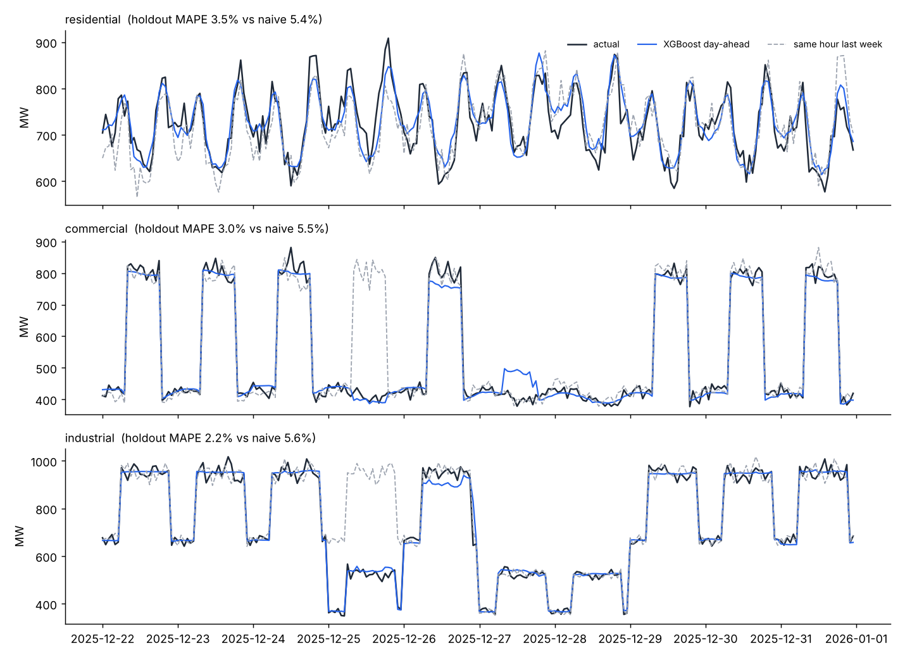

# Energy Load Forecasting

[](https://github.com/SamuelJCB/energy-load-forecasting/actions/workflows/tests.yml)  

Day-ahead electricity demand forecasting for **residential, commercial, and industrial** load segments, built around XGBoost with automated data ingestion and drift-triggered retraining.

This repository is a public, reproducible version of the forecasting workflow I designed as a Venture Fellow in the Harvard Undergrad Ventures-TECH Summer Program (2025). The program work used partner data that cannot be shared, so this version ships with a weather-driven synthetic data generator. Every number below comes from running the code in this repository.



## What it does

| Stage | Module | Details |
|---|---|---|
| Ingest | `ingest.py` | Watches a landing folder for new CSV drops, validates schema and value ranges, rejects bad rows, de-duplicates (later corrections win), appends to the store, and archives processed files. |
| Features | `features.py` | Calendar and cyclical encodings, holidays, heating and cooling degree hours, and load lags at 24h, 48h, and 168h. Every load-derived feature is lagged at least 24 hours, so the model never sees information that would be unavailable when a day-ahead forecast is issued. |
| Model | `model.py` | One XGBoost model per segment. The target is load relative to its trailing weekly mean, which lets tree models follow level shifts they never saw in training. |
| Retrain | `cli.py retrain` | Ingests new data, scores each saved model on the most recent two weeks, and retrains only the segments whose error has drifted past a tolerance. |

## Results on the synthetic dataset

Three years of hourly data per segment, with a 28-day holdout. The baseline is a seasonal-naive forecast (same hour, previous week).

| Segment | XGBoost MAPE | Seasonal-naive MAPE | Error reduction |
|---|---|---|---|
| Residential | 3.48% | 5.42% | 35.8% |
| Commercial | 2.95% | 5.50% | 46.3% |
| Industrial | 2.23% | 5.60% | 60.2% |

### Drift scenario

The generator can apply a step change to one segment, for example a large new data center joining the commercial class. Adding two months of data with a 15% commercial step produces:

```
residential  recent MAPE 3.56% vs trained 3.48% -> ok
commercial   recent MAPE 4.46% vs trained 2.95% -> retrain
industrial   recent MAPE 2.15% vs trained 2.23% -> ok
```

Only the commercial model is retrained, and its holdout error returns to 3.20%.

## Quick start

```bash
pip install -r requirements.txt

python -m energy_forecast generate   # synthetic history as monthly drops in data/landing/
python -m energy_forecast ingest     # validate and merge into data/store.csv
python -m energy_forecast train      # train and evaluate one model per segment
python -m energy_forecast plot       # writes docs/forecast.png

# simulate a structural change and let the pipeline react
python -m energy_forecast generate --start 2026-01-01 --end "2026-02-28 23:00" \
    --seed 11 --shift-segment commercial --shift-pct 15
python -m energy_forecast retrain
```

Run the tests with `pytest`.

## Design notes

- **Why a level-normalized target?** Gradient-boosted trees cannot predict values outside the range they were trained on. A raw-megawatt model trained before a demand step keeps forecasting the old level indefinitely. Predicting the ratio to the trailing weekly mean fixes this within about a week of new data, and it also improved holdout accuracy on every segment.
- **Why per-segment models?** The three segments respond to different drivers. Residential load follows temperature and evening routines, commercial load follows business hours, and industrial load follows shift schedules and holidays. Separate models keep the feature importances interpretable for each customer class.
- **Leakage control.** The holdout is strictly later in time than the training data, the early-stopping set is carved from the end of the training window, and the test suite asserts that no load feature is lagged less than 24 hours.

## Project layout

```
energy_forecast/
  data.py       synthetic weather-driven load generator
  ingest.py     validation, de-duplication, archiving
  features.py   leakage-safe feature engineering
  model.py      XGBoost training, evaluation, drift detection
  cli.py        generate / ingest / train / retrain / plot
tests/          pytest suite
```

## License

MIT
